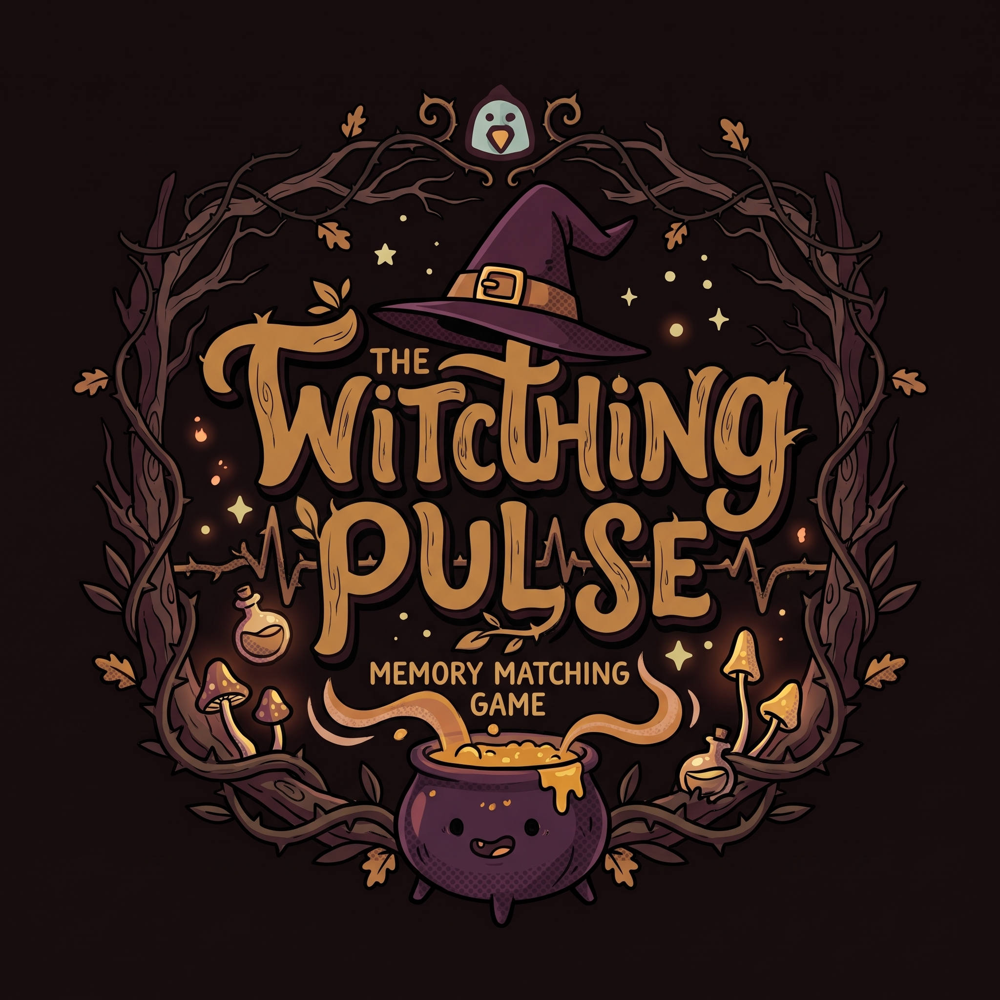

# The Witching Pulse - Memory Matching Game

## Technologies Used
* HTML
* CSS
* JavaScript

## Description
A dark atmospheric memory-matching card game set under a moonlit canopy. Players flip cards against a ticking clock to uncover mysterious creatures and hidden potions. Success requires more than just finding pairs—uncovering friendly creatures restores your life essence (hearts), while missteps risk draining your hearts until the darkness overtakes you.

## User Stories
1. As a user(Player), I want to be able to interact on the cards, so I can play the game.
2. As a user(Player), I want to be able to gain hearts, so I can win the game.
3. As a user(Player), I want to be able to lose hearts, so I can lose the game.

## Screenshots

## Future Enhancements

## Credits